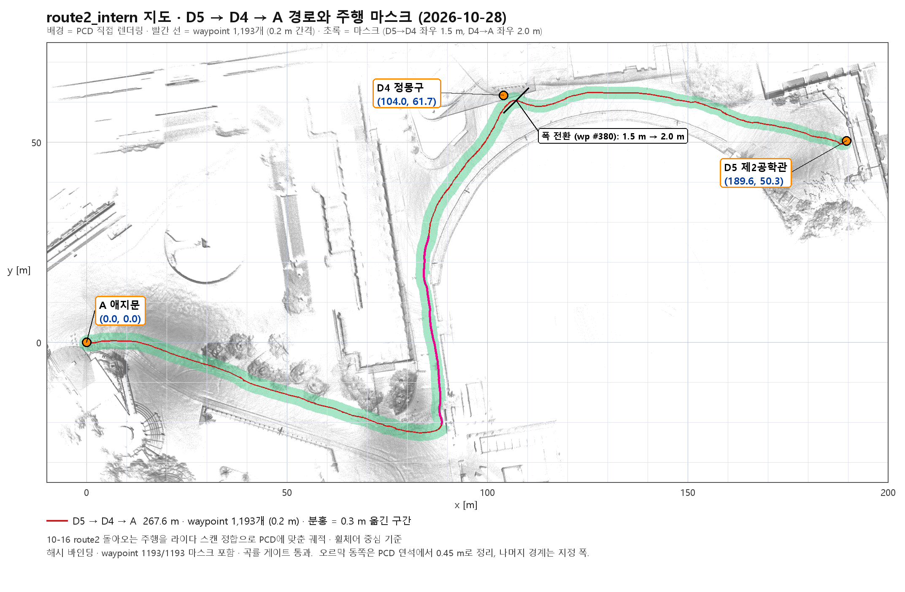

# route2_intern 지도와 D5 → D4 → A 경로 (2026-10-28)



2026-10-16 route2 매핑 주행(애지문 A → 정몽구 D4 → 제2공학관 D5 → D4 → A)을 GLIM으로
재처리한 새 지도와, 그 지도 위의 D5 → D4 → A 주행 자산이다. **아직 한 번도 자율 주행하지
않은 초안**이다.

> 2026-10-30부터 NUC의 기본 경로다. `~/hybrid_current.sh`가 배포본의
> `tools/route2_intern_env.sh`로 지도·경로·밴드·마스크를 한꺼번에 정하므로, 앱의 [로컬 켜기]와
> `~/start_wheelchair_localization.sh`, `~/start_route2_intern.sh`가 모두 이 자산을 쓴다.
> 이전 지도(merged 0707/0725 + v9)는 `ROUTE_SET=v9`. 저장소의
> `tools/start_wheelchair_localization.sh` 자체 기본값은 그대로다.

## 파일

| 경로 | 내용 |
| --- | --- |
| `maps/route2_intern_20261026/route2_intern.pcd` | GLIM 지도, 386만 점, PCD binary XYZI (Git LFS) |
| `maps/route2_intern_20261026/traj_lidar.txt` | 자동 초기화 후보용 궤적 (`t x y z qx qy qz qw`, 지도 좌표) |
| `maps/route2_intern_20261026/metadata.json` | SHA-256, 정합 방법, 목적지 좌표 |
| `routes/20261028_route2_D5_to_A_waypoints.json` | 경로: 1,193 waypoint, 0.2 m, 267.6 m, `chair_centre`, `builtin` |
| `routes/20261028_route2_D5_to_A_safety_band.json` | 안전 밴드: 0.5 m 간격 536 station (마스크 경계까지 좌우 거리) |
| `routes/route_2d_map_route2_D5_to_A.{pgm,yaml,png}` | 2D 주행 마스크: 0.1 m/px, origin (-66.9, -108.8), 2946 × 2157 |

경로·밴드·마스크는 `route_assets.validate_asset_binding`으로 SHA-256 결속되어 있다.
마스크 YAML과 JSON은 LF로 저장했고, 해시도 LF 바이트 기준이다.

## 좌표 (지도 좌표, m)

원점 (0, 0)은 route2 주행 시작 시 센서 위치, 즉 애지문 A.

| 지점 | x | y |
| --- | ---: | ---: |
| A 애지문 | 0.00 | 0.00 |
| D1 국제교육관 | 75.91 | -35.11 |
| J 갈림길 (B·C 방향이 갈라지는 곳) | 64.19 | -18.68 |
| J (route2가 북쪽으로 꺾는 모서리) | 86.75 | -20.72 |
| D4 정몽구 | 104.03 | 61.71 |
| D5 제2공학관 | 189.59 | 50.27 |

## 경로를 만든 방법

1. 10-16 FAST-LIO `/Odometry` 궤적과 `/livox/lidar` 스캔(ROS2 bag)을 사용.
2. 스캔 1,377장을 한 장씩 PCD의 수직 구조물(벽·나무·난간, 지면 위 0.25–1.6 m 기둥)에
   2D ICP로 맞추고, 그 보정을 시간에 따라 보간해 모든 자세를 지도 좌표로 옮겼다.
   벽 점의 중앙값 93%가 PCD 벽 0.2 m 이내. right 주행(A → D1)도 따로 보정했고, 두 주행이
   함께 지나간 구간에서 0.07–0.57 m로 일치한다.
3. 돌아오는 구간(D5 출발 → A 도착)을 잘라 `make_route_waypoints_from_trace.py`,
   `recentre_route_to_chair.py`로 0.2 m 경로를 만들었다. D5 출발 시 제자리 회전 1.8 m는 제외.
4. 운영자 수정 (경로 파일에 기록됨)
   - `local_corner_rounding`: D4 굽은 곳 (108.6, 59.8) ±6 m를 최대 0.43 m 둥글게
     (곡률 게이트 0.329 m/s < 0.35).
   - `operator_lateral_shift`: A → D4 오르막(waypoint #566–776)을 동쪽 연석에서 0.3 m 더
     떨어지게 서쪽으로 이동, 앞뒤 4 m 테이퍼.
5. 마스크(휠체어 중심 영역)
   - D5 → D4 (waypoint #0–380): 경로 좌우 1.5 m
   - D4 → A (waypoint #380–끝): 경로 좌우 2.0 m
   - 오르막 #566–776의 동쪽 끝은 PCD 연석·벽에서 휠체어 중심이 0.45 m 이상 떨어지도록 잘랐다
     (중앙값 1.12 m, 최소 0.43 m).
6. 밴드는 각 station에서 마스크 경계까지 좌우 거리 (`candidate_mask_clip`).

검증: 결속 통과, waypoint 1,193개 모두 마스크 안, 곡률 게이트
(`docs/nuc_snapshot/curvature_profile.py`) exit 0.

## 주의

- **궤적만 지도에 맞추는 방법은 쓰지 말 것.** 가장 가까운 지도 점까지 거리로 맞추면 0.03 m로
  보이지만 실제로는 최대 6.7 m 틀렸다. 길 전체가 지면 점으로 덮여 있어 아무것도 제약하지 못한다.
- `traj_lidar.txt`는 GLIM이 낸 궤적이 아니라 위 2번으로 보정한 FAST-LIO 궤적이다. z는 지도
  지면 + 0.69 m 근사. 자동 초기화 전역 탐색이 실패하면 GLIM 처리 PC의 `traj_lidar.txt`로 바꾼다.
- 마스크 경계는 오르막 동쪽만 PCD로 확인했다. 나머지는 지정 폭이며 실측 연석이 아니다.
  0.25 m 미만의 낮은 턱·낙차는 PCD 검사로도 잡히지 않는다.
- J에서 꺾는 모서리 바깥쪽(대략 (89, -21))은 마스크가 연석 선에 닿아 있다. 첫 주행 때 확인.
- body frame profile은 `builtin`(10-16 매핑은 Livox 내장 IMU) 가정.
- 첫 주행은 탑승·조이스틱·저속.

## 실행

NUC에서는 `~/start_route2_intern.sh`(또는 `~/start_wheelchair_localization.sh`) 하나로 된다.
배포본 없이 체크아웃에서 직접 띄울 때는 지도 4개 변수를 함께 바꿔야 시작 스크립트가 받아들인다.

```bash
R=$HOME/wheelchair_localization_src
MAP=$R/maps/route2_intern_20261026/route2_intern.pcd \
MAP_SHA256=e0809f29a7c185b7e40b3cb1889e558fa5aa0bec51834023681d19cb77f74432 \
MAP_ID=route2_intern_20261026 \
TRAJ=$R/maps/route2_intern_20261026/traj_lidar.txt \
TRAJ_SHA256=0a4b35d9039343293afd74e2522b5b8dd5ac36ab124d34dfe9aa62d41e508ef5 \
ROUTE=$R/routes/20261028_route2_D5_to_A_waypoints.json \
BAND=$R/routes/20261028_route2_D5_to_A_safety_band.json \
DRIVABLE_MASK=$R/routes/route_2d_map_route2_D5_to_A.yaml \
PROFILE=dwa \
  ./tools/start_wheelchair_localization.sh
```

PCD는 Git LFS에 있으므로 NUC에서 `git lfs pull`이 필요하다.
